


<a href="https://arnold-rg.github.io/arnold-portfolio/">Portfolio</a>
&nbsp;·&nbsp;
<a href="https://arnold-rg.github.io/Arnold-RG/">Profile</a>
&nbsp;·&nbsp;
<a href="https://github.com/Arnold-RG">GitHub</a>
&nbsp;·&nbsp;
<a href="https://www.linkedin.com/in/rurangwa-arnold-53b90520b/">LinkedIn</a>
&nbsp;·&nbsp;
<a href="mailto:rurangwaarnold32@gmail.com">Email</a>

## About

Computer engineer working in software, Linux and IT support, and cybersecurity / SOC. I design understandable systems, careful interfaces, and explicit security boundaries.

## Stack

<strong>Languages</strong>

<strong>Frameworks</strong>

<strong>Tools</strong>

## GitHub stats

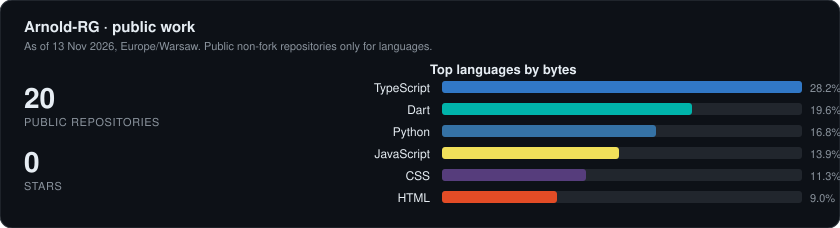

## Projects

Each card is a live public site. The [portfolio](https://arnold-rg.github.io/arnold-portfolio/) is a text link only.

<!-- 13 live project cards, two per row. Screenshots: assets/projects/*.webp -->

<table>
<tr>
<td width="50%" valign="top">
<a href="https://arnold-rg.github.io/elvora/">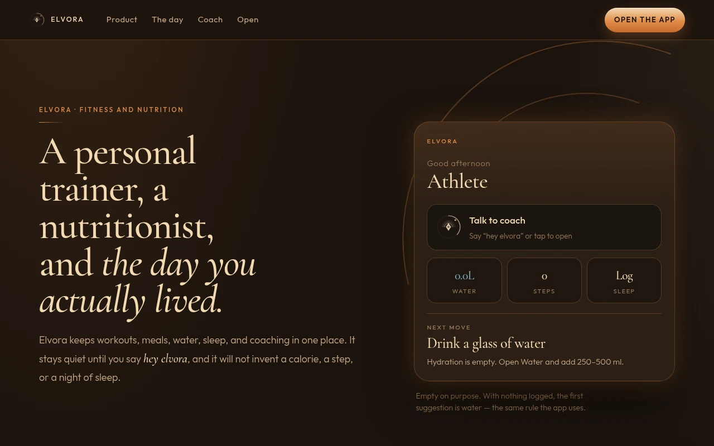</a>
<h3>Elvora</h3>

On-device AI health coach for food, training, hydration, and recovery.

<a href="https://arnold-rg.github.io/elvora/">Live</a> ·
<a href="https://github.com/Arnold-RG/elvora">GitHub</a> 

</td>
<td width="50%" valign="top">
<a href="https://arnold-rg.github.io/study-atlas/">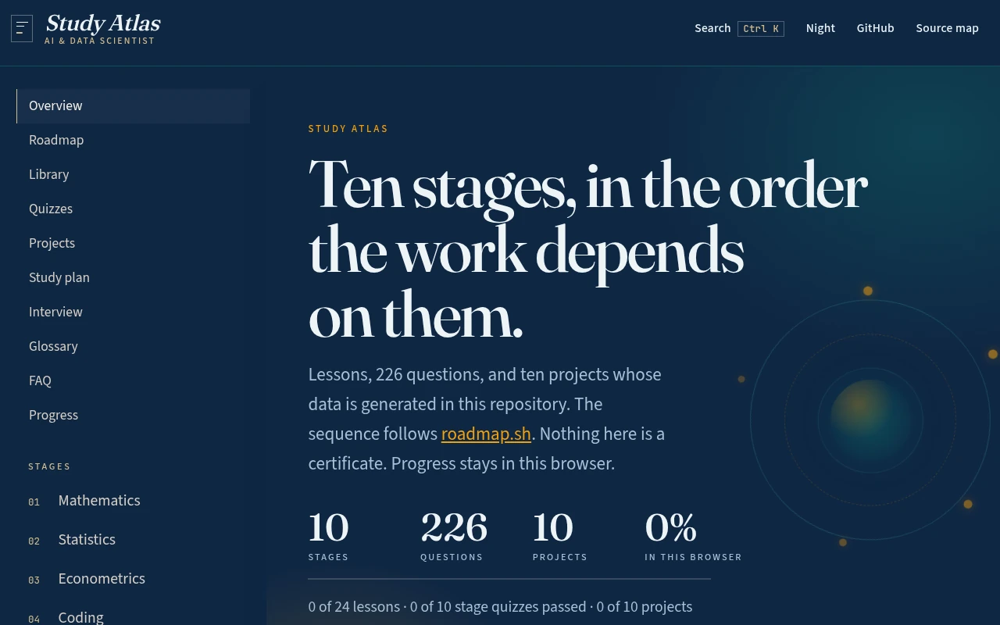</a>
<h3>Study Atlas</h3>

Study curriculum for AI and data science: 10 stages, quizzes, tests, and original projects aligned to roadmap.sh.

<a href="https://arnold-rg.github.io/study-atlas/">Live</a> ·
<a href="https://github.com/Arnold-RG/study-atlas">GitHub</a> 

</td>
</tr>
<tr>
<td width="50%" valign="top">
<a href="https://arnold-rg.github.io/worldshield-soc/">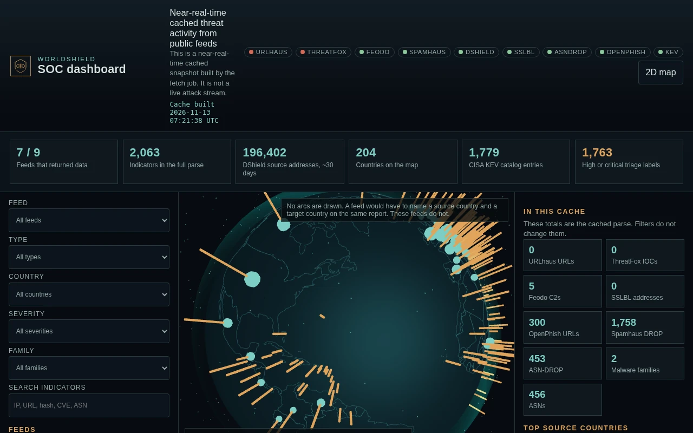</a>
<h3>WorldShield SOC</h3>

Global cyber threat dashboard built from real public feeds, with an AI SOC analyst and automated ops.

<a href="https://arnold-rg.github.io/worldshield-soc/">Live</a> ·
<a href="https://github.com/Arnold-RG/worldshield-soc">GitHub</a> 

</td>
<td width="50%" valign="top">
<a href="https://arnold-rg.github.io/hamwe/">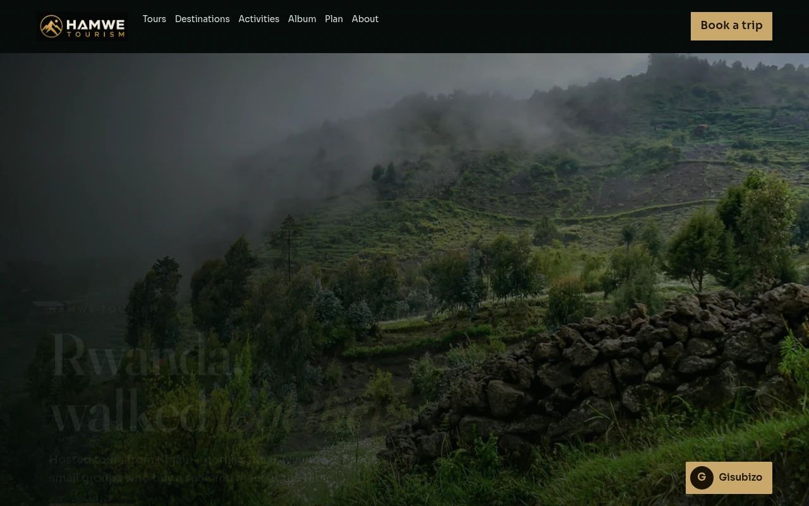</a>
<h3>Hamwe</h3>

Hamwe Tourism plans full Rwanda tours for small groups, hosted from Kigali.

<a href="https://arnold-rg.github.io/hamwe/">Live</a> ·
<a href="https://github.com/Arnold-RG/hamwe">GitHub</a> 

</td>
</tr>
<tr>
<td width="50%" valign="top">
<a href="https://arnold-rg.github.io/vira/">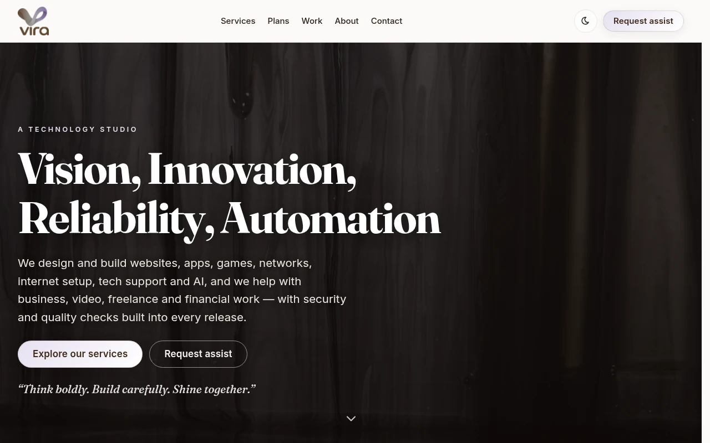</a>
<h3>Vira</h3>

Studio site for intelligent websites, systems, and automation.

<a href="https://arnold-rg.github.io/vira/">Live</a> ·
<a href="https://github.com/Arnold-RG/vira">GitHub</a> 

</td>
<td width="50%" valign="top">
<a href="https://arnold-rg.github.io/2daymovie/">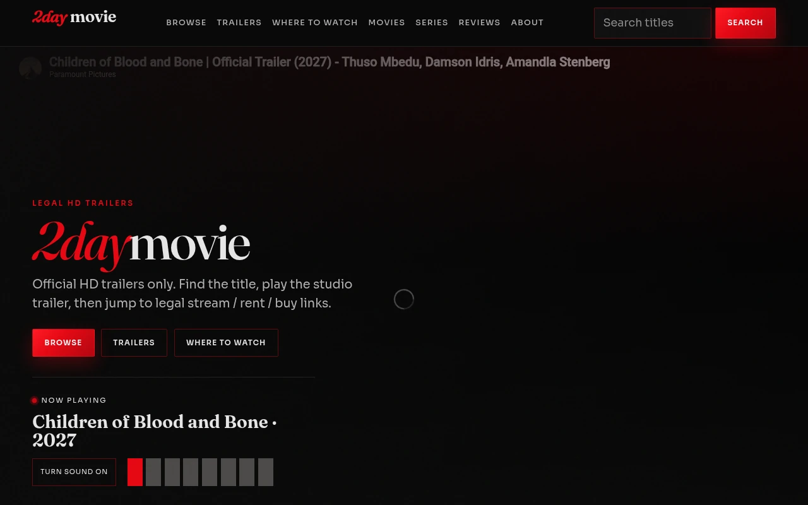</a>
<h3>2daymovie</h3>

Legal movie discovery: official HD trailers, browse, and where to watch.

<a href="https://arnold-rg.github.io/2daymovie/">Live</a> ·
<a href="https://github.com/Arnold-RG/2daymovie">GitHub</a> 

</td>
</tr>
<tr>
<td width="50%" valign="top">
<a href="https://arnold-rg.github.io/STANS/">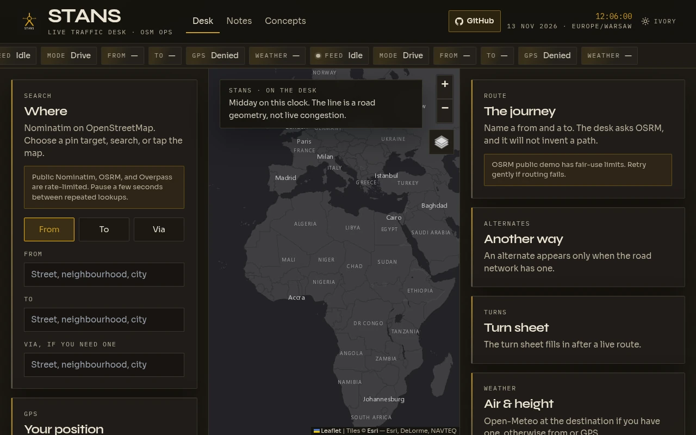</a>
<h3>STANS</h3>

Live OpenStreetMap traffic desk: Nominatim search, OSRM routing, GPS, weather, and Overpass points of interest.

<a href="https://arnold-rg.github.io/STANS/">Live</a> ·
<a href="https://github.com/Arnold-RG/STANS">GitHub</a> 

</td>
<td width="50%" valign="top">
<a href="https://arnold-rg.github.io/peakwise/">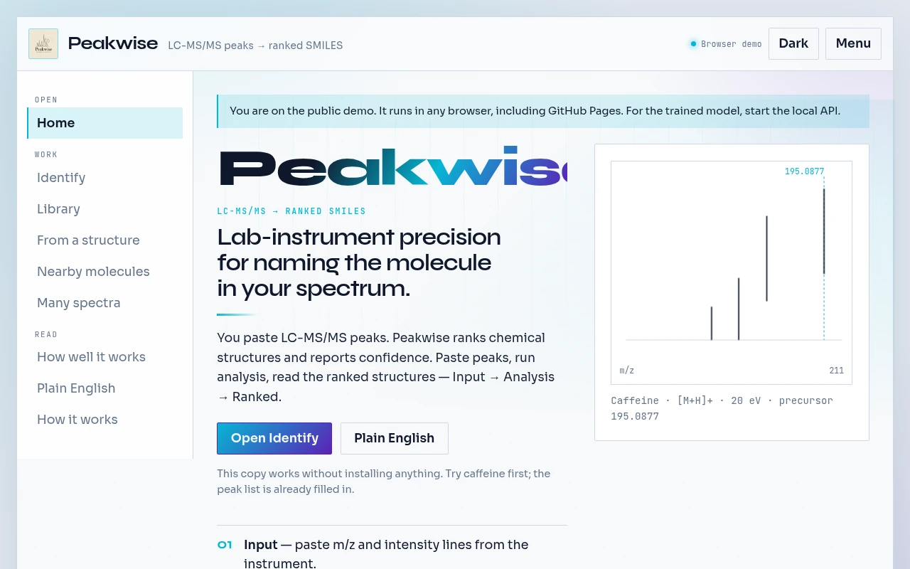</a>
<h3>Peakwise</h3>

Name the molecule in your mass spectrum: LC-MS/MS peaks to SMILES, in the browser.

<a href="https://arnold-rg.github.io/peakwise/">Live</a> ·
<a href="https://github.com/Arnold-RG/peakwise">GitHub</a> 

</td>
</tr>
<tr>
<td width="50%" valign="top">
<a href="https://arnold-rg.github.io/ragi/">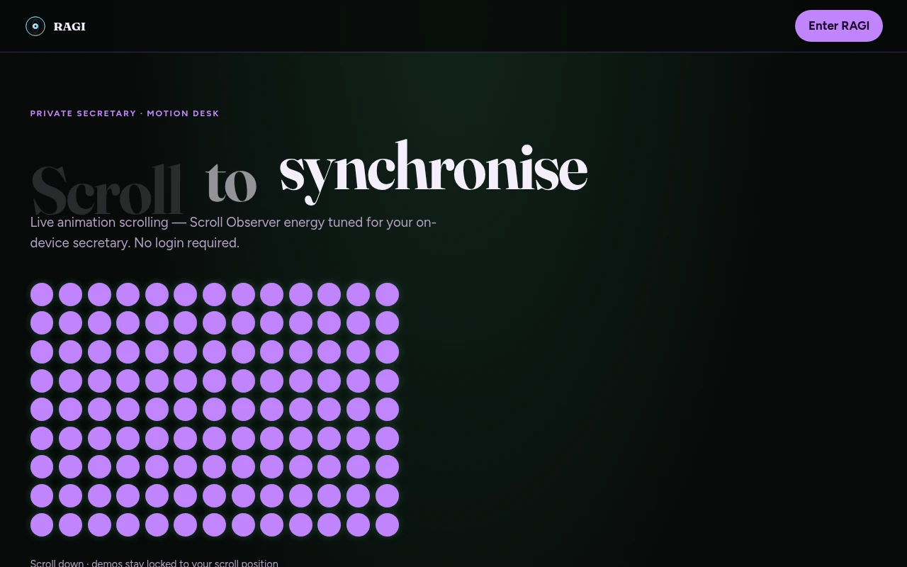</a>
<h3>RAGI</h3>

On-device private secretary for notes, money, and projects, with an optional self-hosted backend.

<a href="https://arnold-rg.github.io/ragi/">Live</a> ·
<a href="https://github.com/Arnold-RG/ragi">GitHub</a> 

</td>
<td width="50%" valign="top">
<a href="https://arnold-rg.github.io/our-money-hub/">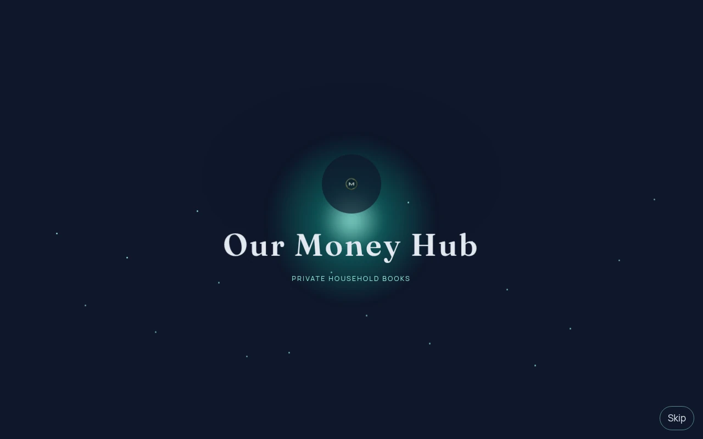</a>
<h3>Our Money Hub</h3>

Private household ledger: shared books, savings, and plans in the browser.

<a href="https://arnold-rg.github.io/our-money-hub/">Live</a> ·
<a href="https://github.com/Arnold-RG/our-money-hub">GitHub</a> 

</td>
</tr>
<tr>
<td width="50%" valign="top">
<a href="https://arnold-rg.github.io/AbroadCost/">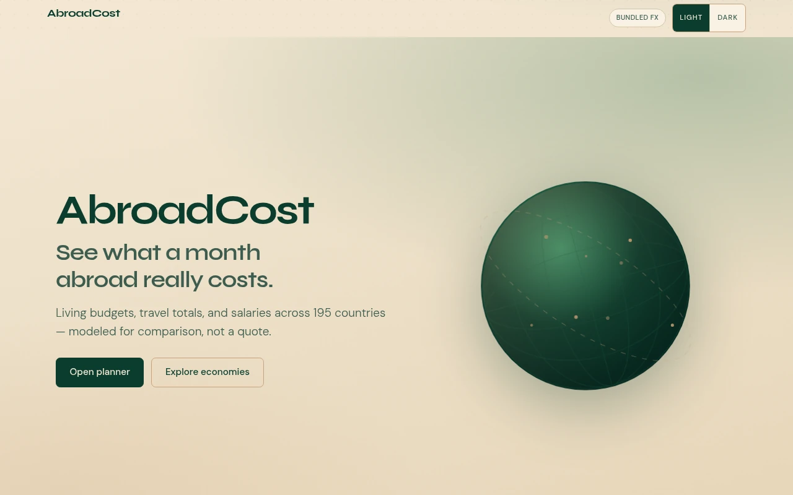</a>
<h3>AbroadCost</h3>

Country budget planner for 195 countries: living costs, travel budgets, and salaries.

<a href="https://arnold-rg.github.io/AbroadCost/">Live</a> ·
<a href="https://github.com/Arnold-RG/AbroadCost">GitHub</a> 

</td>
<td width="50%" valign="top">
<a href="https://arnold-rg.github.io/Boutique-la-difference/">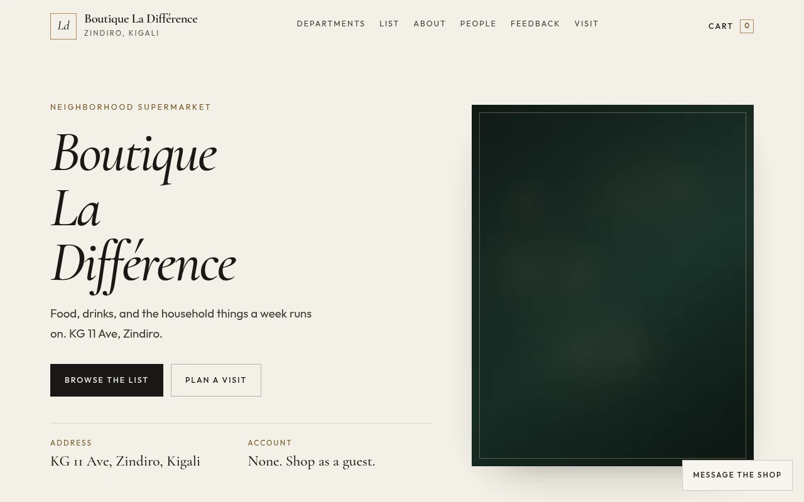</a>
<h3>Boutique La Différence</h3>

Neighborhood supermarket storefront in Zindiro, Kigali — food, drinks, electronics, home goods, tools, and body products.

<a href="https://arnold-rg.github.io/Boutique-la-difference/">Live</a> ·
<a href="https://github.com/Arnold-RG/Boutique-la-difference">GitHub</a> 

</td>
</tr>
<tr>
<td width="50%" valign="top">
<a href="https://arnold-rg.github.io/kingdom-life-krakow/">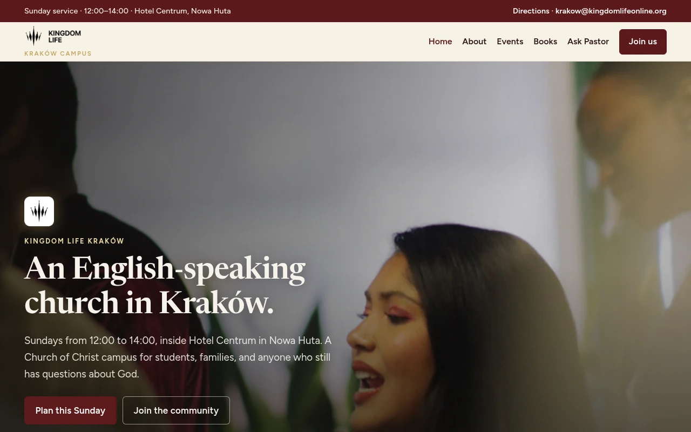</a>
<h3>Kingdom Life Kraków</h3>

Public English church website for Kingdom Life Krakow. Sunday 12:00 at Hotel Centrum.

<a href="https://arnold-rg.github.io/kingdom-life-krakow/">Live</a> ·
<a href="https://github.com/Arnold-RG/kingdom-life-krakow">GitHub</a> 

</td>
<td width="50%" valign="top">
</td>
</tr>
</table>

## Networking & Security Tools

PowerShell and bash tools for network discovery, port scanning, device monitoring, hardening audits and log analysis. [Full overview with quick starts](security-tools.md).

| Tool | What it does | CI |
|---|---|---|
| [Network Scanner](https://github.com/Arnold-RG/network-scanner) | Finds live hosts on a subnet and shows IP, hostname and common open ports. |  |
| [Port Scanner](https://github.com/Arnold-RG/port-scanner) | TCP connect scan of a host, IP range or CIDR block with port lists and ranges, timeouts, parallel probes, banner grab and CSV/JSON output. |  |
| [Network Monitor](https://github.com/Arnold-RG/network-monitor) | Compares devices on the network against a known-devices list and logs and alerts on new devices or IP changes. |  |
| [Security Hardening Checker](https://github.com/Arnold-RG/security-hardening-checker) | Read-only audit of Windows and Linux security settings (firewall, Defender, UAC, SMBv1, RDP, SSH, file permissions and more) with PASS/WARN/FAIL and a score. |  |
| [Log Analyzer](https://github.com/Arnold-RG/log-analyzer) | Finds failed logins, brute force, lockouts, new admin users and cleared logs in Windows Event Logs and Linux auth logs. |  |

## Selected open work

A curated selection of open, non-Dependabot pull requests on public project repositories, as of 13 November 2026, Europe/Warsaw. Drafts are marked. This is not a complete list.

- [2daymovie#14](https://github.com/Arnold-RG/2daymovie/pull/14) — Improve security, catalog performance and phone navigation
- [2daymovie#13](https://github.com/Arnold-RG/2daymovie/pull/13) — draft · Fix GitHub Pages links for hero trailers and upcoming titles
- [2daymovie#1](https://github.com/Arnold-RG/2daymovie/pull/1) — Restore Live Reviews and polish glass review cards
- [kingdom-life-krakow#9](https://github.com/Arnold-RG/kingdom-life-krakow/pull/9) — draft · Kingdom Life Kraków redesign
- [kingdom-life-krakow#2](https://github.com/Arnold-RG/kingdom-life-krakow/pull/2) — draft · Center dock-page copy, Home-only YouTube, and full footers
- [kingdom-life-krakow#1](https://github.com/Arnold-RG/kingdom-life-krakow/pull/1) — draft · Fix responsive alignment; desktop top nav, mobile dock
- [worldshield-soc#3](https://github.com/Arnold-RG/worldshield-soc/pull/3) — draft · Add a public 3D SOC dashboard
- [worldshield-soc#2](https://github.com/Arnold-RG/worldshield-soc/pull/2) — draft · Remove the old company name from public text
- [AbroadCost#3](https://github.com/Arnold-RG/AbroadCost/pull/3) — Remove the old company name from public text
- [AbroadCost#2](https://github.com/Arnold-RG/AbroadCost/pull/2) — Ship referenced assets in the GitHub Pages deploy
- [STANS#11](https://github.com/Arnold-RG/STANS/pull/11) — draft · Remove the old company name from public files
- [STANS#9](https://github.com/Arnold-RG/STANS/pull/9) — draft · Steady the live desk: fair-use lookups, saved stops, and shareable maps
- [peakwise#19](https://github.com/Arnold-RG/peakwise/pull/19) — draft · Remove personal paths and names from the setup docs
- [peakwise#18](https://github.com/Arnold-RG/peakwise/pull/18) — draft · Remove personal paths from the README setup steps
- [peakwise#17](https://github.com/Arnold-RG/peakwise/pull/17) — draft · Upgrade python-multipart, pytest, and Starlette to clear advisories
- [elvora#2](https://github.com/Arnold-RG/elvora/pull/2) — draft · Upgrade FastAPI and python-dotenv past known advisories
- [ragi#3](https://github.com/Arnold-RG/ragi/pull/3) — draft · Fix high-severity Prisma deepmerge-ts audit findings
- [ragi#2](https://github.com/Arnold-RG/ragi/pull/2) — draft · Go live: GitHub Pages public link for RAGI chamber
- [our-money-hub#1](https://github.com/Arnold-RG/our-money-hub/pull/1) — draft · Give each person a private account and redraw the household book

## Education

**B.Sc. Computer Engineering — Cybersecurity** · Wrocławska Akademia Biznesu WSH · 2022–2025

## Security

Vulnerability reports for any Arnold-RG project: see each repository’s `SECURITY.md`, or email **rurangwaarnold32@gmail.com**. Prefer private disclosure for unpatched findings.
