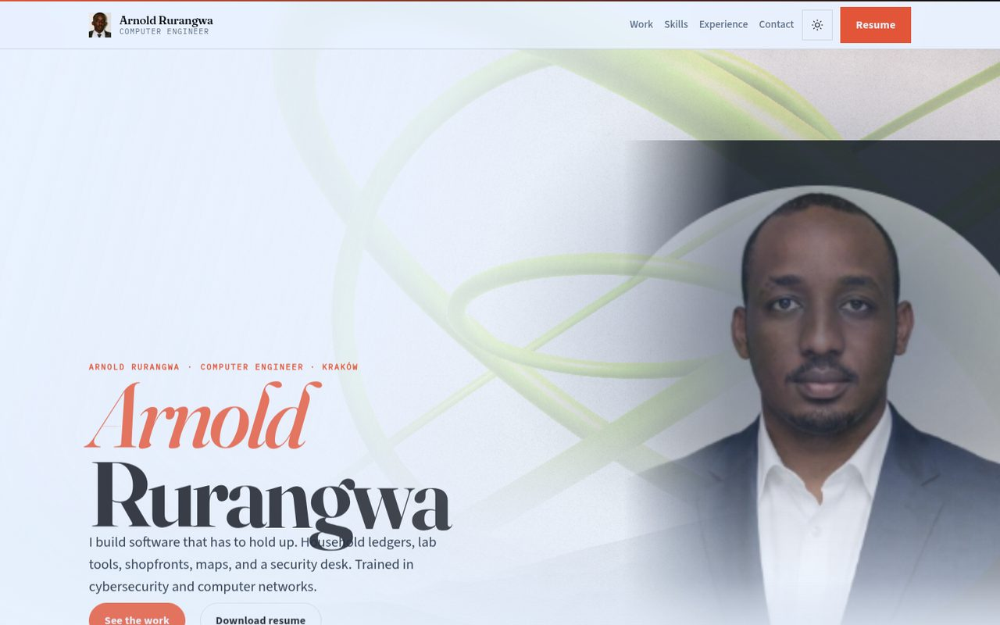

<h1>

</h1>

**Computer Engineer** — software, Linux, IT support, and cybersecurity / SOC.

Kraków, Poland · Open to engineering roles

[Portfolio](https://arnold-rg.github.io/arnold-portfolio/)
·
[Profile site](https://arnold-rg.github.io/Arnold-RG/)
·
[LinkedIn](https://www.linkedin.com/in/rurangwa-arnold-53b90520b/)
·
[Email](mailto:rurangwaarnold32@gmail.com)

---

## About

I build practical software for the web, the desktop, and operations work. My interests sit at the meeting point of **software engineering**, **Linux and IT support**, and **cybersecurity / SOC** practice: clear architecture, careful interfaces, and honest data.

Trained in software systems and cybersecurity in Wrocław, 2022–2025. I focus on understandable systems, accessible interfaces, and explicit security boundaries.

## Skills

| Area | Focus |
| --- | --- |
| **Software** | TypeScript, React, Python, Flutter, Node.js, FastAPI, HTML/CSS |
| **Linux & IT support** | Linux administration, troubleshooting, hardware and software support, networking fundamentals |
| **Cybersecurity & SOC** | Secure application design, threat reporting, public-feed monitoring, network basics |
| **Applied AI** | Study systems, health coaching, model APIs and evaluation |
| **Delivery** | GitHub Actions, Docker, GitHub Pages, documentation |

**Languages** — Python · TypeScript · JavaScript · Dart · Java · C++ · PHP · SQL  
**Data & cloud** — PostgreSQL · MySQL · Docker · AWS · Azure · GitHub Actions

## Projects

Each project has its own live URL. Descriptions match what the code actually does.

| Project | What it is | Live | Source |
| --- | --- | --- | --- |
| [Portfolio](https://arnold-rg.github.io/arnold-portfolio/) | Personal engineering folio, experience, and resume | [Live](https://arnold-rg.github.io/arnold-portfolio/) | [Repo](https://github.com/Arnold-RG/arnold-portfolio) |
| [Hamwe Tourism](https://arnold-rg.github.io/hamwe/) | Rwanda tourism storefront (React / Vite), with the root Pages site | [Live](https://arnold-rg.github.io/hamwe/) | [Repo](https://github.com/Arnold-RG/Arnold-RG.github.io) |
| [Africa Shield](https://arnold-rg.github.io/Africa-shield-cyber-centre/) | Public threat-intelligence and reporting desk for security operations | [Live](https://arnold-rg.github.io/Africa-shield-cyber-centre/) | [Repo](https://github.com/Arnold-RG/Africa-shield-cyber-centre) |
| [STANS](https://arnold-rg.github.io/STANS/) | Live traffic desk: OpenStreetMap search, OSRM routing, weather, nearby help | [Live](https://arnold-rg.github.io/STANS/) | [Repo](https://github.com/Arnold-RG/STANS) |
| [Peakwise](https://arnold-rg.github.io/peakwise/) | LC-MS/MS peak lists ranked into chemical structures (SMILES) | [Live](https://arnold-rg.github.io/peakwise/) | [Repo](https://github.com/Arnold-RG/peakwise) |
| [Elvora](https://arnold-rg.github.io/nfl-bot/) | Flutter app and site for fitness, nutrition, and a personal coach | [Live](https://arnold-rg.github.io/nfl-bot/) | [Repo](https://github.com/Arnold-RG/nfl-bot) |
| [2daymovie](https://arnold-rg.github.io/2daymovie/) | Official HD movie and TV trailers — no full-film streaming | [Live](https://arnold-rg.github.io/2daymovie/) | [Repo](https://github.com/Arnold-RG/2daymovie) |
| [AbroadCost](https://arnold-rg.github.io/AbroadCost/) | Country budget planner for 195 countries | [Live](https://arnold-rg.github.io/AbroadCost/) | [Repo](https://github.com/Arnold-RG/AbroadCost) |
| [AI & Data Scientist Roadmap](https://arnold-rg.github.io/ai-data-scientist-roadmap/) | Lessons, Python exercises, quizzes, and portfolio projects | [Live](https://arnold-rg.github.io/ai-data-scientist-roadmap/) | [Repo](https://github.com/Arnold-RG/ai-data-scientist-roadmap) |
| [Boutique La Différence](https://arnold-rg.github.io/Boutique-la-difference/) | Retail catalogue, cart, and shop-management admin | [Live](https://arnold-rg.github.io/Boutique-la-difference/) | [Repo](https://github.com/Arnold-RG/Boutique-la-difference) |
| [Kingdom Life Kraków](https://arnold-rg.github.io/kingdom-life-krakow/) | Public English-language church website | [Live](https://arnold-rg.github.io/kingdom-life-krakow/) | [Repo](https://github.com/Arnold-RG/kingdom-life-krakow) |
| [Our Money Hub](https://arnold-rg.github.io/our-money-hub/) | Shared household books, savings, and plans | [Live](https://arnold-rg.github.io/our-money-hub/) | [Repo](https://github.com/Arnold-RG/our-money-hub) |
| [RAGI](https://arnold-rg.github.io/ragi/) | On-device workspace for notes, money, and projects | [Live](https://arnold-rg.github.io/ragi/) | [Repo](https://github.com/Arnold-RG/ragi) |

A public demonstration may offer fewer features than a self-hosted backend. Project READMEs describe setup, deployment, and limitations.

## Education

**B.Sc. Computer Engineering** — Cybersecurity  
Wrocławska Akademia Biznesu WSH · Wrocław, Poland · 2022–2025

## Security note

Vulnerability reports for any Arnold-RG project: see each repository’s `SECURITY.md`, or email **rurangwaarnold32@gmail.com**. Prefer private disclosure over public issues for unpatched findings.

<em>Based in Kraków, Poland · Open to engineering roles and collaboration.</em>

