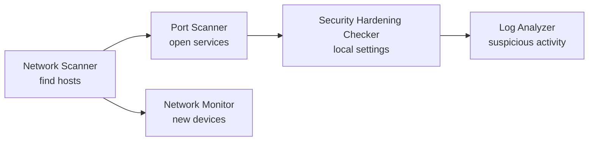

# Networking & Security Tools

Five command-line tools for network discovery, monitoring, hardening and log analysis. Each one has a PowerShell version for Windows and a bash version for Linux, a README with real example output, and automated tests on GitHub Actions.

> Only scan or audit networks and machines you own or are authorized to test.

[Back to profile](README.md)

| Tool | What it does | Windows | Linux |
|---|---|---|---|
| [Network Scanner](https://github.com/Arnold-RG/network-scanner) | Finds live hosts on a subnet and shows IP, hostname and common open ports. Includes a Cisco Packet Tracer lab (VLANs, DHCP, router-on-a-stick). | `scan-network.ps1 -Target 192.168.1.0/24` | `./scan-network.sh 192.168.1.0/24` |
| [Port Scanner](https://github.com/Arnold-RG/port-scanner) | TCP connect scan of a host, IP range or CIDR block with port lists and ranges, timeouts, parallel probes, banner grab and CSV/JSON output. | `port-scan.ps1 -Target 127.0.0.1 -Ports 1-1024` | `./port-scan.sh -p 1-1024 127.0.0.1` |
| [Network Monitor](https://github.com/Arnold-RG/network-monitor) | Compares devices on the network against a known-devices list and logs and alerts on new devices or IP changes. Run once or on an interval. | `monitor-network.ps1 -Once` | `./monitor-network.sh -1` |
| [Security Hardening Checker](https://github.com/Arnold-RG/security-hardening-checker) | Read-only audit of Windows and Linux security settings (firewall, Defender, UAC, SMBv1, RDP, SSH, file permissions and more) with PASS/WARN/FAIL and a score. | `check-windows.ps1` | `sudo ./check-linux.sh` |
| [Log Analyzer](https://github.com/Arnold-RG/log-analyzer) | Finds failed logins, brute force, lockouts, new admin users and cleared logs in Windows Event Logs and Linux auth logs. Ships with synthetic sample logs. | `analyze-windows-logs.ps1 -Hours 24` | `./analyze-linux-logs.sh samples/auth.log.sample` |



## [Network Scanner](https://github.com/Arnold-RG/network-scanner)

[](https://github.com/Arnold-RG/network-scanner/actions/workflows/ci.yml)   

Finds live hosts on a subnet and shows IP, hostname and common open ports. Includes a Cisco Packet Tracer lab (VLANs, DHCP, router-on-a-stick).

```bash
git clone https://github.com/Arnold-RG/network-scanner.git && cd network-scanner
./scan-network.sh 192.168.1.0/24
```

```powershell
git clone https://github.com/Arnold-RG/network-scanner.git; cd network-scanner
.\scan-network.ps1 -Target 192.168.1.0/24
```

## [Port Scanner](https://github.com/Arnold-RG/port-scanner)

[](https://github.com/Arnold-RG/port-scanner/actions/workflows/ci.yml)   

TCP connect scan of a host, IP range or CIDR block with port lists and ranges, timeouts, parallel probes, banner grab and CSV/JSON output.

```bash
git clone https://github.com/Arnold-RG/port-scanner.git && cd port-scanner
./port-scan.sh -p 1-1024 127.0.0.1
```

```powershell
git clone https://github.com/Arnold-RG/port-scanner.git; cd port-scanner
.\port-scan.ps1 -Target 127.0.0.1 -Ports 1-1024
```

## [Network Monitor](https://github.com/Arnold-RG/network-monitor)

[](https://github.com/Arnold-RG/network-monitor/actions/workflows/ci.yml)   

Compares devices on the network against a known-devices list and logs and alerts on new devices or IP changes. Run once or on an interval.

```bash
git clone https://github.com/Arnold-RG/network-monitor.git && cd network-monitor
./monitor-network.sh -1
```

```powershell
git clone https://github.com/Arnold-RG/network-monitor.git; cd network-monitor
.\monitor-network.ps1 -Once
```

## [Security Hardening Checker](https://github.com/Arnold-RG/security-hardening-checker)

[](https://github.com/Arnold-RG/security-hardening-checker/actions/workflows/ci.yml)   

Read-only audit of Windows and Linux security settings (firewall, Defender, UAC, SMBv1, RDP, SSH, file permissions and more) with PASS/WARN/FAIL and a score.

```bash
git clone https://github.com/Arnold-RG/security-hardening-checker.git && cd security-hardening-checker
sudo ./check-linux.sh
```

```powershell
git clone https://github.com/Arnold-RG/security-hardening-checker.git; cd security-hardening-checker
.\check-windows.ps1
```

## [Log Analyzer](https://github.com/Arnold-RG/log-analyzer)

[](https://github.com/Arnold-RG/log-analyzer/actions/workflows/ci.yml)   

Finds failed logins, brute force, lockouts, new admin users and cleared logs in Windows Event Logs and Linux auth logs. Ships with synthetic sample logs.

```bash
git clone https://github.com/Arnold-RG/log-analyzer.git && cd log-analyzer
./analyze-linux-logs.sh samples/auth.log.sample
```

```powershell
git clone https://github.com/Arnold-RG/log-analyzer.git; cd log-analyzer
.\analyze-windows-logs.ps1 -Hours 24
```
